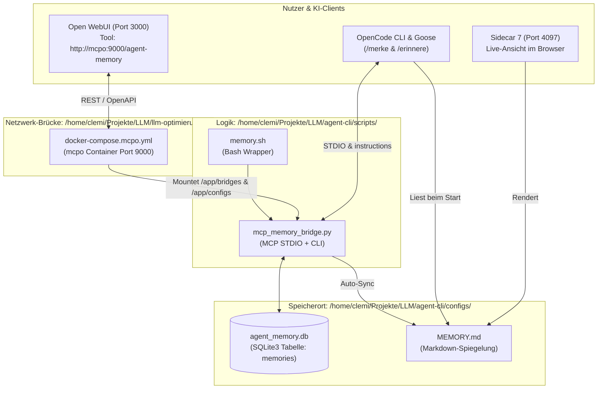

# 📍 01. Bestandsanalyse: Wo liegt dein lokales Gedächtnis & wie einfach ist der Ausbau?

> **Kurzantwort:** Dein aktuelles lokales Gedächtnis liegt in **`/home/clemi/Projekte/LLM/agent-cli/configs/`** (`agent_memory.db` + `MEMORY.md`) und wird über das Skript **`scripts/mcp_memory_bridge.py`** (sowie per Docker-Gateway **`mcpo`** auf Port `9000`) bereitgestellt.  
> Der Ausbau zu einem vollwertigen **Digitalen Zwilling mit Dokumenten-Konvertierung (PDF ➔ Markdown) und 3-stufigem Obsidian-Gehirn** ist auf deiner bestehenden Infrastruktur **sehr einfach (Aufwand: ca. 1–2 Stunden bzw. hier bereits schlüsselfertig vorbereitet)**, da Ollama, Python, SQLite und das MCP-Gateway (`mcpo`) bereits laufen.

---

## 🗺️ 1. Exakte Landkarte deines aktuellen Gedächtnisses

Aktuell besitzt dein System ein **Dual-Layer Agenten-Gedächtnis**, das für kurze Systemregeln, Ports und Architekturentscheidungen gebaut wurde:

### Alle beteiligten Dateien im Überblick:

1. **Datenbank (Primärspeicher):**  
   [`/home/clemi/Projekte/LLM/agent-cli/configs/agent_memory.db`](file:///home/clemi/Projekte/LLM/agent-cli/configs/agent_memory.db)  
   *Enthält die SQLite-Tabelle `memories` mit den Spalten `key`, `category`, `project`, `content`, `updated_at`.*
2. **Markdown-Datei (Kontext-Injektion):**  
   [`/home/clemi/Projekte/LLM/agent-cli/configs/MEMORY.md`](file:///home/clemi/Projekte/LLM/agent-cli/configs/MEMORY.md)  
   *Wird bei jeder Änderung aus der SQLite-DB neu generiert und über [`opencode.json`](file:///home/clemi/Projekte/LLM/agent-cli/configs/opencode.json) (`"instructions"`) automatisch in jede Sitzung geladen.*
3. **Python MCP-Server:**  
   [`/home/clemi/Projekte/LLM/agent-cli/scripts/mcp_memory_bridge.py`](file:///home/clemi/Projekte/LLM/agent-cli/scripts/mcp_memory_bridge.py)  
   *Stellt die 4 MCP-Werkzeuge `memory_save`, `memory_search`, `memory_list` und `memory_delete` bereit.*
4. **OpenAPI / Docker-Einbindung (`mcpo`):**  
   [`/home/clemi/Projekte/LLM/llm-optimierungen/configs/mcpo/config.json`](file:///home/clemi/Projekte/LLM/llm-optimierungen/configs/mcpo/config.json) & [`docker-compose.mcpo.yml`](file:///home/clemi/Projekte/LLM/llm-optimierungen/docker-compose.mcpo.yml)  
   *Reicht die SQLite-Datenbank in den `mcpo`-Container durch, sodass auch **Open WebUI** im Browser darauf zugreifen kann.*

---

## ⚖️ 2. Was fehlt dem aktuellen Gedächtnis für einen „Digitalen Zwilling“?

| Anforderung | Aktuelles `agent_memory.db` | Neues `digital-twin-memory` (Dieses Projekt) |
| :--- | :--- | :--- |
| **Speicher-Typ** | Kurze Fakten (1–2 Sätze pro Key) | Ganze Dokumente, Bücher, Berichte, Notizen |
| **Dateiformat-Import** | ❌ Nur manueller Text (`/merke`) | ✅ **PDF, DOCX, ODT, PPTX, XLSX, HTML, Audio ➔ `.md`** |
| **Obsidian-Kompatibilität** | ⚠️ Nur eine einzige Tabelle (`MEMORY.md`) | ✅ **Echter Obsidian-Vault** mit YAML-Frontmatter & `[[WikiLinks]]` |
| **Gehirn-Struktur** | 1 flache Tabelle | ✅ **3-Stufige Gehirn-Ebenen** (Fleeting ➔ Literature ➔ Permanent) |
| **Such-Technologie** | Einfaches `SQL LIKE %...%` | ✅ **SQLite FTS5 (BM25 Ranking) + Semantische Chunks** |
| **KI-Bearbeitung** | Überschreiben einzelner Keys | ✅ **Lesen, Zusammenfassen, Verknüpfen & Ebenen-Aufstieg per KI** |

---

## 🛠️ 3. Wie einfach ist die Umsetzung? (Aufwand & Machbarkeit)

Da deine Workstation (AMD Radeon PRO W7800 mit 48 GB VRAM, 128 GB RAM, Ollama, `mcpo`, OpenCode) bereits komplett eingerichtet ist, ist die Umsetzung **extrem einfach und erfordert keinerlei Cloud-Dienste**:

### Warum ist es hier so einfach?
1. **Markdown ist die gemeinsame Muttersprache von Obsidian UND lokalen LLMs:**  
   Wenn wir PDFs, Word- oder LibreOffice-Dokumente (`.odt`) sauber in Markdown mit YAML-Header umwandeln, kann **Obsidian** sie sofort als vernetzten Wissensgraphen darstellen, und deine lokalen Modelle (`qwen3-coder`, `qwen3.8-35b-distill`, `qwen3-next-80b`) können sie nativ lesen, durchsuchen und bearbeiten.
2. **0 MB VRAM für die Dokumenten-Datenbank:**  
   Durch den Einsatz von **SQLite FTS5 (BM25 Volltextindex)** kombiniert mit optionalen CPU-Embeddings (`nomic-embed-text` oder `bge-m3` via CPU/ONNX) bleibt dein gesamter 48 GB VRAM zu 100 % frei für deine großen Sprachmodelle.
3. **Nahtlose Integration per MCP (Model Context Protocol):**  
   Ein einziges Python-Skript ([`scripts/mcp_obsidian_twin.py`](file:///home/clemi/Projekte/LLM/digital-twin-memory/scripts/mcp_obsidian_twin.py)) genügt, um den Obsidian-Vault als **aktives Werkzeug** in OpenCode, Goose und (über `mcpo`) in Open WebUI einzuhängen.

### Die 3 Umsetzungs-Bausteine (in diesem Ordner bereits fertig angelegt):
* **Baustein 1 — Dokumenten-Konverter ([`scripts/ingest_to_markdown.py`](file:///home/clemi/Projekte/LLM/digital-twin-memory/scripts/ingest_to_markdown.py)):**  
  Überwacht den Ordner `vault/00_inbox_raw/` oder nimmt Dateien per Befehl entgegen, extrahiert Text, Tabellen und Überschriften aus PDF/DOCX/ODT/HTML und legt sie sauber formatiert in **Ebene 1 (`01_fleeting_notes/`)** ab.
* **Baustein 2 — 3-Ebenen Obsidian-Vault ([`vault/`](file:///home/clemi/Projekte/LLM/digital-twin-memory/vault)):**  
  Trennt sauber zwischen ungefiltertem Roh-Input (**Ebene 1**), strukturierten Exzerpten (**Ebene 2**) und deinem verifizierten Langzeit-Wissen (**Ebene 3**).
* **Baustein 3 — KI-Gedächtnis-Server ([`scripts/mcp_obsidian_twin.py`](file:///home/clemi/Projekte/LLM/digital-twin-memory/scripts/mcp_obsidian_twin.py)):**  
  Erlaubt der lokalen KI, gezielt in bestimmten Gehirn-Ebenen zu suchen (mit Prioritäts-Boost für Ebene 3!), Notizen zusammenzufassen und von Ebene 1 nach Ebene 2 oder 3 zu befördern (`promote_brain_layer`).
