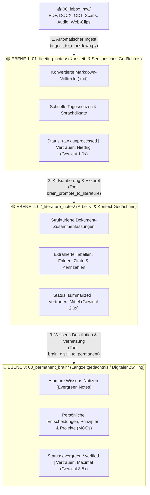

# 🧠 02. Architektur: Die 3-Stufige Trennung der Gehirn-Ebenen (Obsidian + Lokale KI)

> **Kernidee:** Ein „Digitaler Zwilling“ scheitert in der Praxis fast immer daran, dass hunderte ungefilterte PDF-Seiten und verifizierte eigene Erkenntnisse in denselben Topf geworfen werden (typisches RAG-Rauschen).  
> Durch die **3-stufige Trennung nach dem Obsidian-/Zettelkasten-Prinzip** weiß deine lokale KI jederzeit: *Was ist nur fremdes Rohmaterial (Ebene 1), was ist geprüftes Exzerpt (Ebene 2) und was ist mein wahres Langzeit-Wissen (Ebene 3)?*

---

## 🏛️ 1. Die 3 Gehirn-Ebenen im Detail



---

### 🟢 Ebene 1: Sensorisches / Kurzzeit-Gehirn (`vault/01_fleeting_notes/`)
* **Rolle in Obsidian:** *Fleeting Notes / Inbox-Markdown*.
* **Was liegt hier?**
  * Alle frisch aus `00_inbox_raw/` umgewandelten Dokumente (z. B. ein 40-seitiges PDF-Handbuch, eine `.odt`-Dokumentation wie `doku1.odt` oder eine Rechnung als `.md`).
  * Schnelle Sprachnotizen (über dein `Super + V` Whisper-Diktat) und unfertige Gedanken.
* **Eigenschaft für die KI:**
  * Enthält den **100 % vollständigen Originaltext** für Detail-Nachfragen (*„Was stand auf Seite 14 im PDF zum Thema X?“*).
  * Hat bei allgemeinen Suchanfragen aber die **niedrigste Priorität (`Gewicht: 1.0`)**, damit rohe Textmassen nicht deine eigenen Entscheidungen überlagern.

---

### 🟡 Ebene 2: Arbeits- & Literatur-Gedächtnis (`vault/02_literature_notes/`)
* **Rolle in Obsidian:** *Literature Notes / Source Summaries*.
* **Was liegt hier?**
  * Verdichtete, strukturierte Zusammenfassungen der Dokumente aus Ebene 1.
  * Jede Datei in Ebene 2 verweist per Obsidian-WikiLink (`source_note: "[[01_fleeting_notes/doku1]]"`) auf das Originaldokument in Ebene 1.
  * Enthält: **Kernaussagen, wichtige Parameter/Zahlen, offene Fragen und relevante Tags**.
* **Wie entsteht Ebene 2?**
  * Du sagst deiner lokalen KI (z. B. in OpenCode oder Open WebUI):  
    *„Analysiere das neue Dokument in Ebene 1 (`doku1.md`) und erstelle daraus eine strukturierte Literatur-Notiz in Ebene 2.“*
  * Die KI nutzt das MCP-Tool `brain_promote_note` und legt das Exzerpt sauber verlinkt in `02_literature_notes/` an.
* **Eigenschaft für die KI:**
  * Mittlere bis hohe Priorität (`Gewicht: 2.0`). Ideal, um schnell über dutzende Dokumente hinweg Zusammenhänge zu finden, ohne jedes Mal tausende Zeilen Roh-PDF lesen zu müssen.

---

### 🔵 Ebene 3: Langzeit-Gehirn / Digitaler Zwilling (`vault/03_permanent_brain/`)
* **Rolle in Obsidian:** *Permanent Notes / Evergreen Zettelkasten / Maps of Content (MOCs)*.
* **Was liegt hier?**
  * Dein **echter Digitaler Zwilling**: Atomare Konzepte, deine eigenen Architekturentscheidungen, Workflows, Personen-/Projekt-Dossiers und verifiziertes Wissen.
  * Reichhaltig untereinander vernetzt mit `[[WikiLinks]]` (sichtbar im **Obsidian Graph View** als zentrale Knotenpunkte) und zurückverlinkt auf die Quellen in Ebene 2 (`sources: ["[[02_literature_notes/...]]"]`).
* **Eigenschaft für die KI:**
  * **Höchste Priorität (`Gewicht: 3.5`)**: Wenn du die KI etwas fragst (*„Wie lösen wir das Backup-Problem?“* oder *„Was ist unsere Strategie für X?“*), prüft die KI **zuerst Ebene 3**. Nur wenn Details aus den Ursprungsdokumenten fehlen, folgt sie automatisch den `[[WikiLinks]]` hinab in Ebene 2 und Ebene 1!

---

## 🏷️ 2. Einheitlicher Metadaten-Standard (YAML-Frontmatter für Obsidian & KI)

Jede Markdown-Datei im Vault erhält automatisch einen standardisierten YAML-Header, den sowohl **Obsidian** (für das Plugin *Dataview*, *Bases* und den *Graph View*) als auch der **SQLite-Index deiner lokalen KI** versteht:

```yaml
---
id: "20261111-doku1"
title: "Systemdokumentation Setup & Architektur"
brain_layer: 1                  # 1 = Fleeting, 2 = Literature, 3 = Permanent
layer_name: "fleeting"          # fleeting | literature | permanent
status: "unprocessed"           # unprocessed | summarized | evergreen | archived
source_file: "00_inbox_raw/doku1.odt"
source_format: "odt"
parent_notes: []                # WikiLinks zu Quellen, z. B. ["[[01_fleeting_notes/doku1]]"]
tags:
  - "brain/layer1"
  - "import/odt"
created_at: "2026-11-11 09:40"
updated_at: "2026-11-11 09:40"
---
```

### Warum ist dieses Frontmatter so mächtig?
1. **In Obsidian:** Du kannst im Obsidian Graph View nach `tag:#brain/layer1` (Grau), `tag:#brain/layer2` (Gelb) und `tag:#brain/layer3` (Blau/Grün) einfärben und siehst sofort visuell, wie dein Wissen reift.
2. **Für die lokale KI:** Der MCP-Server liest `brain_layer: 1|2|3` direkt aus und gewichtet Treffer aus Ebene 3 automatisch um den Faktor `3.5x` höher als ungefilterte Rohdokumente aus Ebene 1.

---

## 🔄 3. Wie fragst und bearbeitest du die 3 Ebenen mit deiner lokalen KI?

Über den mitgelieferten MCP-Server ([`scripts/mcp_obsidian_twin.py`](file:///home/clemi/Projekte/LLM/digital-twin-memory/scripts/mcp_obsidian_twin.py)) stehen deinen lokalen Modellen (`qwen3-coder`, `qwen3.8-35b-distill`, `qwen3-next-80b`) 6 spezialisierte Werkzeuge zur Verfügung:

| MCP-Tool | Funktion für die lokale KI | Typischer Prompt von dir im Chat |
| :--- | :--- | :--- |
| **`brain_ingest_file`** | Wandelt eine Datei (PDF, DOCX, ODT, HTML, TXT) in Markdown um und speichert sie in **Ebene 1**. | *„Lies die Datei `/pfad/vertrag.pdf` in mein Gedächtnis ein.“* |
| **`brain_search`** | Durchsucht alle 3 Ebenen (BM25 + Layer-Boosting) oder filtert gezielt nach Ebene `1`, `2` oder `3`. | *„Was weiß mein Gedächtnis über ROCm Speichergrenzen? Prüfe zuerst Ebene 3.“* |
| **`brain_read_note`** | Liest eine komplette Obsidian-Notiz inklusive aller ausgehenden `[[WikiLinks]]` und Backlinks. | *„Lies die Notiz `02_literature_notes/doku1_exzerpt.md` und folge den Links.“* |
| **`brain_write_note`** | Erstellt oder bearbeitet eine Notiz in Ebene 1, 2 oder 3 (inkl. sauberem YAML-Frontmatter). | *„Erstelle in Ebene 3 eine neue Permanent-Note zum Thema Backup-Strategie.“* |
| **`brain_promote_note`** | Befördert Wissen von **Ebene 1 ➔ Ebene 2** oder **Ebene 2 ➔ Ebene 3** und setzt automatisch die `[[WikiLinks]]` zur Ursprungsnotiz. | *„Fasse `01_fleeting_notes/doku1.md` zusammen und befördere die Kernaussagen nach Ebene 2.“* |
| **`brain_graph_stats`** | Zeigt die Verteilung der Notizen über die 3 Ebenen, verwaiste Notizen und unkonvertierte Dateien in `00_inbox_raw`. | *„Zeige mir den Status meines 3-Ebenen-Gehirns.“* |
