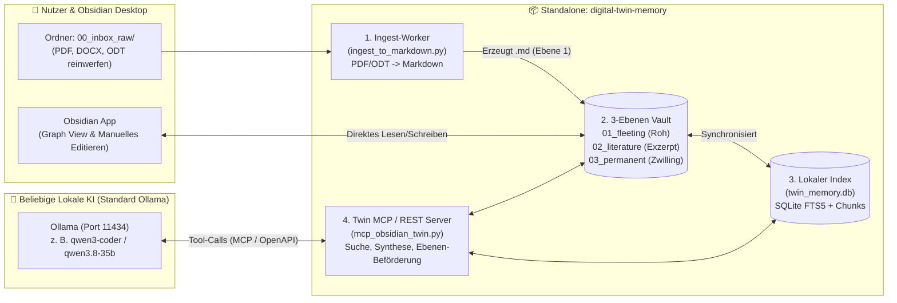

# ⚖️ 04. Architektur-Vergleich: Standalone-Projekt (`digital-twin-memory`) vs. `llm-optimierungen`

> **Deine Frage:** *„Wie würde ein Standalone-Projekt nur für diese Anwendung als Alternative zur `llm-optimierung` aussehen?“*  
> Hier siehst du den direkten Gegenüberstellungs-Vergleich zwischen deinem bestehenden Infrastruktur-Projekt [`llm-optimierungen`](file:///home/clemi/Projekte/LLM/llm-optimierungen) und diesem neuen, komplett eigenständigen Wissens- & Dokumenten-Projekt [`digital-twin-memory`](file:///home/clemi/Projekte/LLM/digital-twin-memory).

---

## 🔍 1. Philosophie- & Architektur-Vergleich

| Merkmal | ⚙️ Bestehendes `llm-optimierungen` | 🧠 Neues Standalone `digital-twin-memory` |
| :--- | :--- | :--- |
| **Primäres Ziel** | **Maschinenraum & Performance:** Maximale Token/s auf der AMD W7800, Speculative Decoding, VRAM-Schutz, Kernel-Tuning, Git-Hooks. | **Wissen, Dokumente & Digitaler Zwilling:** PDF/Office-Import, Obsidian 3-Ebenen-Gehirn, hybride Suche und kuratierte KI-Bearbeitung. |
| **Wohin fließen die Daten?** | In flüchtige Modell-Kontexte oder kurze Systemregeln (`agent_memory.db`). | In einen **dauerhaften, menschenlesbaren Obsidian-Vault** (`vault/01..03`) + **SQLite-FTS5/Vektor-Index**. |
| **Abhängigkeiten** | Tief im Linux-Host verankert (`systemd`, `sysctl`, Kernel-Parameter, `llama.cpp`, ROCm). | **100 % portabel & autark:** Reines Dateisystem (`.md`), SQLite und ein Standard-Ollama/OpenAI-Endpunkt. |
| **Wem gehören die Daten?** | Konfigurationsdateien für technische Agenten. | **Deinem „Second Brain“ in Obsidian:** Selbst wenn du alle KI-Container abschaltest, bleibt dein gesamtes Wissen als sauberes Markdown mit `[[WikiLinks]]` in Obsidian nutzbar! |
| **VRAM-Verbrauch des Projekts** | Steuert bis zu 45 GB VRAM (`llama-swap`, Modelfiles). | **Exakt 0 MB eigener VRAM-Bedarf** (Dokumenten-Parser und FTS5-Index laufen komplett auf der CPU). |

---

## 🏗️ 2. Wie sieht der Standalone-Stack technisch aus?

Wenn man `digital-twin-memory` **komplett unabhängig** von `llm-optimierungen` betreibt (z. B. auf einem beliebigen Linux-Rechner, Laptop oder später auf dem NAS), besteht das gesamte Projekt nur aus **4 schlanken Komponenten**:

---

## 🚀 3. Drei Betriebsmodi: Standalone vs. Kombiniert

Du musst dich nicht zwingend für *entweder/oder* entscheiden. Das Projekt [`digital-twin-memory`](file:///home/clemi/Projekte/LLM/digital-twin-memory) ist so gebaut, dass es in **drei Stufen** betrieben werden kann:

### Modus A: 100 % Standalone (Als echte Alternative ohne `llm-optimierungen`)
* Du brauchst **kein** `llama-swap`, **keine** Spezial-Modelfiles und **kein** Systemd-Tuning aus `llm-optimierungen`.
* Ein normales Standard-Ollama (`ollama serve`) + Obsidian Desktop + `./scripts/brain_cli.sh` genügen.
* Ideal, wenn du das System auch auf einem Zweitrechner/Laptop ohne W7800-Spezialkonfiguration exakt gleich nutzen willst.

### Modus B: Standalone Docker-Appliance (`docker-compose.standalone.yml`)
* Startet einen eigenen, isolierten Container-Stack nur für das Dokumenten-Gehirn:
  1. **`twin-watcher`**: Überwacht `vault/00_inbox_raw/` in Echtzeit (`inotify`) und wandelt jede hineingelegte PDF/DOCX/ODT-Datei binnen Sekunden automatisch in `vault/01_fleeting_notes/*.md` um.
  2. **`twin-mcp-api`**: Stellt die 3 Gehirn-Ebenen als eigenen OpenAPI-Server (Port `9005`) bereit.

### Modus C: Synergie-Modus auf `clemi-pc` (Das Beste aus beiden Welten)
* Du nutzt die **Geschwindigkeit** aus `llm-optimierungen` (48 GB VRAM, 62–80 Tokens/s) als Denk-Motor und hängst `digital-twin-memory` einfach als **zweites MCP-Gedächtnis** in `OpenCode` und `Open WebUI` ein:
  * **`agent-memory` (alt):** Merkt sich weiterhin technische Kurz-Fakten (Ports, Hardware, Git-Regeln).
  * **`obsidian-twin` (neu):** Verwaltet deine sämtlichen Dokumente, PDFs, Bücher und das 3-stufige Obsidian-Wissensnetzwerk.
