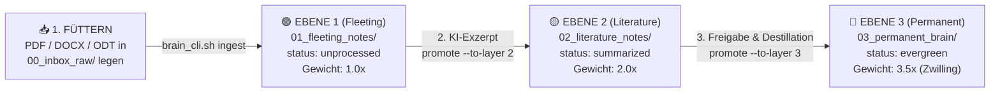

# 🧭 06. Praxis-Handbuch: Wie nutze ich das Zweite Gehirn im Alltag?

> **Ziel:** Eine konkrete Anleitung für die 4 täglichen Kernschritte:  
> 1. **Füttern** (Dokumente einwerfen & in Ebene 1 umwandeln)  
> 2. **Abfragen** (Wissen über alle 3 Ebenen hinweg suchen)  
> 3. **Mit lokaler KI bearbeiten** (Zusammenfassen, Verknüpfen & Erweitern)  
> 4. **Für Ebene 3 („Permanent Brain“) freigeben** (Wissens-Aufstieg vom Rohdokument zum verifizierten Digitalen Zwilling)

---

## 🔄 Der Lebenszyklus eines Dokuments in deinem 2. Gehirn



---

## 📥 Schritt 1: Das Gehirn füttern (Dokumente einlesen)

Du hast **drei Wege**, um neue Dokumente (PDFs, Rechnungen, Bücher, `.docx`, `.odt`, `.xlsx`, `.csv`, `.html`) in dein System zu füttern. Alle landen automatisch als sauberes Markdown mit YAML-Frontmatter in **Ebene 1 (`vault/01_fleeting_notes/`)**:

### Weg A: Über den Drop-Ordner (`00_inbox_raw/`) — *Bester Weg für viele Dateien*
1. Wirf beliebig viele PDFs oder Office-Dateien per Dateimanager in den Ordner:  
   [`/home/clemi/Projekte/LLM/digital-twin-memory/vault/00_inbox_raw/`](file:///home/clemi/Projekte/LLM/digital-twin-memory/vault/00_inbox_raw)
2. Führe im Terminal aus:
   ```bash
   /home/clemi/Projekte/LLM/digital-twin-memory/scripts/brain_cli.sh ingest-all
   ```

### Weg B: Einzelne Datei direkt per Terminal einfüttern
```bash
/home/clemi/Projekte/LLM/digital-twin-memory/scripts/brain_cli.sh ingest /pfad/zu/deiner/datei.pdf
```

### Weg C: Direkt im KI-Chat (OpenCode / Goose / Open WebUI)
Sage deiner lokalen KI einfach im Chat:
> *„Lies bitte die Datei `/home/clemi/Dokumente/Steuer_2026.pdf` mit `brain_ingest_file` in mein Gedächtnis ein.“*

---

## 🔍 Schritt 2: Das Gehirn abfragen (Gezielte Suche über 3 Ebenen)

Sobald Dokumente im Vault liegen, sind sie im **SQLite-FTS5 Volltextindex (`configs/twin_memory.db`)** registriert. Bei jeder Suche gilt automatisch die **Prioritäts-Regel**:
* Treffer in **🔵 Ebene 3 (`03_permanent_brain`)** zählen **`3.5x`** so stark wie Rohdaten.
* Treffer in **🟡 Ebene 2 (`02_literature_notes`)** zählen **`2.0x`** so stark.
* Treffer in **🟢 Ebene 1 (`01_fleeting_notes`)** zählen **`1.0x`** (liefern aber bei Bedarf jedes kleinste Detail aus dem Original-PDF).

### A) Abfrage im KI-Chat (Natürlichsprachlich)
* **Allgemeine Frage an den Zwilling:**  
  *„Durchsuche mein Gehirn (`brain_search`) nach `ROCm` oder `Speicherlimit` und erkläre mir unsere aktuelle Regelung.“*
* **Gezielte Detailfrage an ein Original-PDF (Ebene 1):**  
  *„Suche nur in Ebene 1 (`layer: 1`) nach den genauen Zahlen im Originaldokument und lies die Notiz mit `brain_read_note`.“*

### B) Abfrage direkt im Terminal (`brain_cli.sh`)
```bash
# 1. Über alle 3 Ebenen suchen (Ebene 3 steht automatisch ganz oben!):
./scripts/brain_cli.sh search "Architektur"

# 2. Gezielt NUR in Ebene 3 (deinem verifizierten Langzeit-Wissen) suchen:
./scripts/brain_cli.sh search "Architektur" --layer 3

# 3. Gezielt NUR in den Roh-PDFs (Ebene 1) suchen:
./scripts/brain_cli.sh search "ROCm" --layer 1

# 4. Eine gefundene Notiz inkl. ihrer [[WikiLinks]] komplett anzeigen:
./scripts/brain_cli.sh read "03_permanent_brain/Architektur_Prinzip_3_Ebenen_Gehirn.md"
```

---

## 🤖 Schritt 3: Dokumente mit lokaler KI bearbeiten & zusammenfassen (Ebene 1 ➔ Ebene 2)

Ein frisch konvertiertes PDF in **Ebene 1 (`01_fleeting_notes/`)** hat zunächst den Status `status: "unprocessed"`. Es enthält oft viel Fülltext. Jetzt lässt du deine lokale KI daraus eine saubere **Literatur-Notiz für Ebene 2 (`02_literature_notes/`)** destillieren:

### Option 1: Vollautomatisch per 1-Klick-Befehl (`promote --to-layer 2`)
Der Befehl `promote` schickt das Rohdokument aus Ebene 1 an dein lokales Ollama-Modell, lässt Kernaussagen, Fakten/Zahlen und `[[WikiLinks]]` extrahieren, speichert das Ergebnis in **Ebene 2** und setzt den Status des Rohdokuments automatisch auf `status: "summarized"`:

```bash
# Nutzt dein lokales Modell (Standard: qwen3-coder:latest oder auf 16GB-Systemen twin-14b):
./scripts/brain_cli.sh promote "01_fleeting_notes/doku1.md" \
  --to-layer 2 \
  --title "doku1_System_Exzerpt" \
  --tags "exzerpt,workstation,rocm"
```

### Option 2: Interaktiv im Chat mit OpenCode / Open WebUI
Du diskutierst erst mit der KI über das Dokument und lässt sie das Ergebnis speichern:
> *„Lies `01_fleeting_notes/doku1.md`, ziehe alle Hardware-Tabellen und Speichergrenzen heraus und speichere das als strukturierte Übersicht in **Ebene 2** (`layer: 2`) mit `parent_note: 01_fleeting_notes/doku1`.“*

---

## 👑 Schritt 4: Wann und wie erkläre ich Wissen für „Ebene 3“ (`03_permanent_brain`) bereit?

**Ebene 3 ist das Herzstück deines Digitalen Zwillings.** Hierhin gehört **kein** ungeprüfter Rohtext, sondern nur Wissen, das du als **dauerhaft gültig („Evergreen“)** freigibst (deine eigenen Prinzipien, bestätigte Projektdaten, Architekturentscheidungen, persönliche Checklisten).

### Die 3 Kriterien: Wann ist eine Notiz reif für Ebene 3?
1. **Geprüft & Wahr:** Du hast die KI-Zusammenfassung aus Ebene 2 kurz überflogen (oder in Obsidian ergänzt) und sagst: *„Ja, das stimmt exakt und gilt ab jetzt für mich.“*
2. **Atomar & Eigenständig:** Statt *„Notizen aus dem PDF vom 11.11.“* heißt die Notiz in Ebene 3 z. B. *„VRAM-Sicherheitsregel 41-GiB-Grenze“* oder *„Steuer-Checkliste Freiberufler“*.
3. **Vernetzt (`[[WikiLinks]]`):** Sie verlinkt auf verwandte Konzepte in Ebene 3 und behält im Feld `parent_notes` den Rückverweis auf die Quelle in Ebene 2.

---

### Die 3 Wege, um ein Dokument für Ebene 3 freizugeben („Promotion“):

#### Weg 1: Per Terminal-Befehl (mit KI-Destillation durch Ollama)
Die lokale KI verdichtet dein Exzerpt aus Ebene 2 zu einer zeitlosen **Evergreen-Notiz in Ebene 3** (Gewichtung `3.5x`) und markiert die Quelle als `distilled_to_layer3`:
```bash
./scripts/brain_cli.sh promote "02_literature_notes/doku1_Literatur_Exzerpt.md" \
  --to-layer 3 \
  --title "Regelwerk_Lokale_KI_Workstation" \
  --tags "zwilling,evergreen,architektur"
```

#### Weg 2: Direktes Freigeben einer konkreten Erkenntnis (Terminal oder Chat)
Wenn du eine eigene Entscheidung sofort in Ebene 3 verankern willst:
```bash
./scripts/brain_cli.sh write "VRAM_Sicherheitsgrenze_W7800" \
  "Alle Modelle auf clemi-pc müssen unter 41 GiB VRAM bleiben, damit 4 GiB für GNOME/Wayland frei bleiben. Quelle: [[02_literature_notes/doku1_Literatur_Exzerpt]]." \
  --layer 3 \
  --parent "02_literature_notes/doku1_Literatur_Exzerpt" \
  --tags "regel,hardware,evergreen"
```
*(Oder im Chat: „Befördere unsere Erkenntnis aus `doku1_Literatur_Exzerpt` jetzt als verbindliche Regel nach **Ebene 3**!“)*

#### Weg 3: Direkt visuell in Obsidian (Drag & Drop + Eigenschaften)
Da deine Datenbank (`twin_memory.db`) sich bei jedem Aufruf live mit dem Ordner [`vault/`](file:///home/clemi/Projekte/LLM/digital-twin-memory/vault) synchronisiert, kannst du auch **ohne einen einzigen Befehl direkt in Obsidian** arbeiten:
1. Ziehe eine geprüfte Notiz in Obsidian mit der Maus aus `02_literature_notes/` in den Ordner **`03_permanent_brain/`** (Obsidian passt alle `[[WikiLinks]]` automatisch an!).
2. Beim nächsten Suchlauf erkennt [`mcp_obsidian_twin.py`](file:///home/clemi/Projekte/LLM/digital-twin-memory/scripts/mcp_obsidian_twin.py) automatisch, dass die Datei nun in `03_permanent_brain/` liegt, und gibt ihr sofort den **3.5x Langzeitgedächtnis-Boost**!

---

## 📋 Spickzettel: Deine täglichen 5 Befehle (`brain_cli.sh`)

```bash
# 1. STATUS: Wie viele Dateien liegen in Inbox, Ebene 1, Ebene 2 und Ebene 3?
./scripts/brain_cli.sh status

# 2. FÜTTERN: Alle neuen PDFs/ODTs/DOCX aus 00_inbox_raw nach Ebene 1 wandeln
./scripts/brain_cli.sh ingest-all

# 3. KURATIEREN (1 -> 2): Rohdokument durch lokale KI für Ebene 2 zusammenfassen lassen
./scripts/brain_cli.sh promote "01_fleeting_notes/<datei>.md" --to-layer 2

# 4. FREIGEBEN (2 -> 3): Geprüftes Wissen als Evergreen-Notiz in Ebene 3 verankern
./scripts/brain_cli.sh promote "02_literature_notes/<datei>_Exzerpt.md" --to-layer 3

# 5. ABFRAGEN: Über alle 3 Ebenen suchen (Ebene 3 gewinnt automatisch bei Relevanz!)
./scripts/brain_cli.sh search "<Suchbegriff>"
```
