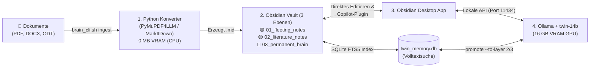
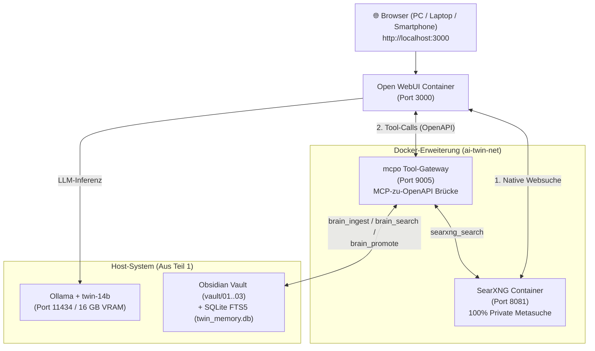

# 🏗️ 07. Komplett-Setup von Null: Vom schlanken Basis-System (Ollama + Obsidian) bis zum Web-Vollausbau (Open WebUI + mcpo + SearXNG)

> **Für wen ist dieses Dokument?**  
> Für einen komplett frisch aufgesetzten Linux-Rechner (Ubuntu/Debian), auf dem **noch gar nichts installiert ist** (kein Ollama, kein Obsidian, kein Docker).  
> **Hardware-Basis im Beispiel:** 16 GB VRAM Grafikkarte (NVIDIA oder AMD), 32 GB System-RAM.  
> **Aufbau in 2 Ausbaustufen:**  
> * **Teil 1 (Basis-Variante — 100 % Nativ & Ohne Docker):** Nur **Ollama + Dokumenten-Konverter + Obsidian** (schnellstes Setup in 10 Minuten).  
> * **Teil 2 (Web-Erweiterung — Docker-Stack):** Ausbau um **Open WebUI** (Browser-Chat), **`mcpo`** (Gedächtnis-API-Brücke) und **SearXNG** (100 % private Live-Websuche).

---

# 🟢 TEIL 1: Die Basis-Variante (Nur Ollama + 3-Ebenen-Gehirn + Obsidian)

Wenn du **ohne Docker und ohne Browser-Server** starten willst, brauchst du nur diese schlanke Basis. Du arbeitest dabei direkt in **Obsidian** (visueller Wissensgraph + KI-Seitenleiste) und über das **Terminal-Werkzeug (`brain_cli.sh`)**.

## 📦 1.1 Was benötigst du für die Basis-Variante?



| Baustein | Zweck | Ressourcenverbrauch |
| :--- | :--- | :--- |
| **1. System-Pakete (`apt`)** | Python 3, SQLite3, `pdftotext`, `pandoc` & `tesseract-ocr-deu` (für PDF-Scans). | `0 MB VRAM` (CPU) |
| **2. Ollama + `twin-14b` (`qwen2.5:14b`)** | Lokales Sprachmodell mit **32k Token Kontext** (~70 Seiten gleichzeitig im Kopf). | `~12,6 GB VRAM` |
| **3. `digital-twin-memory` Skripte** | Wandelt PDF/Word/ODT nach Markdown und verwaltet die 3 Gehirn-Ebenen (`brain_cli.sh`). | `0 MB VRAM` (CPU) |
| **4. Obsidian Desktop App** | Dein „Second Brain“ Editor mit Graph-Ansicht und direkter Ollama-Anbindung. | `0 MB VRAM` |

---

## 🛠️ 1.2 Schritt-für-Schritt-Installation der Basis-Variante

### Schritt 1: Basis-Systempakete & deutsche OCR-Texterkennung installieren
```bash
sudo apt update && sudo apt install -y \
  curl git python3 python3-venv python3-pip \
  poppler-utils tesseract-ocr tesseract-ocr-deu tesseract-ocr-eng \
  pandoc sqlite3 jq
```

### Schritt 2: Ollama installieren & für 16 GB VRAM tunen
```bash
# 1. Offiziellen Ollama-Installer ausführen (erkennt NVIDIA CUDA & AMD ROCm automatisch)
curl -fsSL https://ollama.com/install.sh | sh

# 2. 16-GB-VRAM-Optimierung + CORS-Freigabe für die Obsidian Desktop App setzen
sudo mkdir -p /etc/systemd/system/ollama.service.d
sudo tee /etc/systemd/system/ollama.service.d/override.conf << 'EOF'
[Service]
# Erlaubt der Obsidian Desktop App den direkten Zugriff auf Ollama:
Environment="OLLAMA_ORIGINS=app://obsidian.md*"
# Halbiert den VRAM-Bedarf bei langen PDFs (ermöglicht 32k Kontext auf 16 GB VRAM):
Environment="OLLAMA_FLASH_ATTENTION=1"
Environment="OLLAMA_KV_CACHE_TYPE=q8_0"
Environment="OLLAMA_NUM_PARALLEL=1"
Environment="OLLAMA_MAX_LOADED_MODELS=1"
EOF

sudo systemctl daemon-reload && sudo systemctl restart ollama
```

### Schritt 3: Das 16-GB-Modell (`twin-14b`) + CPU-Embedding-Modell laden
```bash
# 1. Hauptmodell (ca. 9 GB) und kleines Embedding-Modell für Obsidian (~270 MB) laden
ollama pull qwen2.5:14b
ollama pull nomic-embed-text

# 2. Maßgeschneidertes 32k-Kontext-Profil für das 3-Ebenen-Gehirn erstellen
cat << 'EOF' > /tmp/Modelfile.twin16gb
FROM qwen2.5:14b
PARAMETER num_ctx 32768
PARAMETER temperature 0.2
SYSTEM """Du bist mein lokaler Digitaler Zwilling für Obsidian.
Du arbeitest mit einem 3-stufigen Gehirn:
- Ebene 1 (01_fleeting_notes): Konvertierte Rohdokumente aus PDF/DOCX/ODT (Gewicht 1.0x).
- Ebene 2 (02_literature_notes): Kuratierte Zusammenfassungen & Exzerpte (Gewicht 2.0x).
- Ebene 3 (03_permanent_brain): Verifiziertes Langzeitwissen & Entscheidungen (Gewicht 3.5x).
Antworte präzise auf Deutsch und verlinke Quellen immer mit Obsidian [[WikiLinks]]."""
EOF

ollama create twin-14b -f /tmp/Modelfile.twin16gb
```

### Schritt 4: Dokumenten-Konverter (`digital-twin-memory`) aktivieren
```bash
cd /home/clemi/Projekte/LLM/digital-twin-memory

# Richtet die Python-Venv mit PyMuPDF4LLM (PDF->MD) & MarkItDown (DOCX/XLSX->MD) ein:
./setup/01-install-standalone-deps.sh
```

### Schritt 5: Obsidian installieren & direkt mit Ollama verbinden
```bash
# Obsidian Desktop installieren
sudo snap install obsidian --classic
```
1. Öffne **Obsidian** ➔ Klicke auf **„Ordner als Vault öffnen“** ➔ Wähle `/home/clemi/Projekte/LLM/digital-twin-memory/vault`.
2. **So arbeitest du in der Basis-Variante:**
   * **Über das Terminal (`brain_cli.sh`):**
     ```bash
     # 1. PDF/ODT/DOCX aus 00_inbox_raw in Ebene 1 (.md) umwandeln:
     ./scripts/brain_cli.sh ingest-all

     # 2. Rohdokument durch twin-14b zusammenfassen und nach Ebene 2 befördern:
     ./scripts/brain_cli.sh promote "01_fleeting_notes/doku1.md" --to-layer 2 --model "twin-14b"

     # 3. Geprüftes Exzerpt als Evergreen-Wissen für Ebene 3 freigeben:
     ./scripts/brain_cli.sh promote "02_literature_notes/doku1_Exzerpt.md" --to-layer 3 --model "twin-14b"

     # 4. Über alle 3 Ebenen suchen (Ebene 3 hat automatisch 3.5x Priorität!):
     ./scripts/brain_cli.sh search "Architektur"
     ```
   * **Optional direkt in der Obsidian-Oberfläche chatting (*Plugin „Copilot“ oder „Smart Connections“*):**  
     Unter *Obsidian Einstellungen ➔ Community Plugins* kannst du **„Copilot for Obsidian“** installieren, als Provider **Ollama (`http://127.0.0.1:11434`)**, als Chat-Modell **`twin-14b`** und als Embedding-Modell **`nomic-embed-text`** eintragen. Schon hast du rechts in Obsidian ein KI-Chatfenster, das direkt auf deine geöffneten Notizen zugreift!

---
---

# 🔵 TEIL 2: Die Erweiterung (Open WebUI + `mcpo` Tool-Gateway + SearXNG Live-Suche)

Wenn du zusätzlich zur Basis-Variante eine **komfortable ChatGPT-Weboberfläche im Browser (`Open WebUI`)** möchtest, die:
1. von jedem Gerät im Heimnetz/Tailscale erreichbar ist,
2. über **`mcpo`** direkt deine 3 Obsidian-Gehirnebenen durchsuchen, lesen und befördern kann, und
3. über **SearXNG** zu 100 % anonym live im Internet recherchieren kann (z. B. um aktuelle Infos aus dem Web direkt als neue Notiz im Obsidian-Vault zu speichern),

dann erweiterst du Teil 1 einfach um diesen **Docker-Stack**.

## 🏛️ 2.1 Gesamt-Architektur der Ausbaustufe (Teil 1 + Teil 2)



---

## 🛠️ 2.2 Schritt-für-Schritt-Installation der Erweiterung

### Schritt 1: Docker & Docker Compose installieren
```bash
curl -fsSL https://get.docker.com | sudo sh
sudo usermod -aG docker "$USER"
newgrp docker
```

### Schritt 2: Ollama für Docker-Container öffnen
Damit `Open WebUI` aus dem Docker-Container heraus mit deinem `Ollama` auf dem Host sprechen kann, ergänzen wir `OLLAMA_HOST=0.0.0.0:11434` in der Konfiguration aus Teil 1:

```bash
sudo tee /etc/systemd/system/ollama.service.d/override.conf << 'EOF'
[Service]
Environment="OLLAMA_HOST=0.0.0.0:11434"
Environment="OLLAMA_ORIGINS=app://obsidian.md*,http://localhost*,http://127.0.0.1*"
Environment="OLLAMA_FLASH_ATTENTION=1"
Environment="OLLAMA_KV_CACHE_TYPE=q8_0"
Environment="OLLAMA_NUM_PARALLEL=1"
Environment="OLLAMA_MAX_LOADED_MODELS=1"
EOF

sudo systemctl daemon-reload && sudo systemctl restart ollama
```

### Schritt 3: SearXNG-Konfiguration anlegen (JSON-Format für KI-Suche aktivieren)
Damit Open WebUI und deine KI-Agenten Ergebnisse von SearXNG maschinenlesbar als JSON abrufen können, legen wir eine minimale SearXNG-Konfiguration an:

```bash
mkdir -p /home/clemi/Projekte/LLM/digital-twin-memory/configs/searxng

cat << 'EOF' > /home/clemi/Projekte/LLM/digital-twin-memory/configs/searxng/settings.yml
use_default_settings: true
server:
  secret_key: "lokales-zweites-gehirn-searxng-key-2026"
  limiter: false
  image_proxy: true
search:
  safe_search: 0
  autocomplete: "duckduckgo"
  default_lang: "de-DE"
  formats:
    - html
    - json
EOF
```

### Schritt 4: Den kompletten Erweiterungs-Stack starten (`Open WebUI` + `mcpo` + `SearXNG`)
Die fertige Datei [`docker-compose.komplett.yml`](file:///home/clemi/Projekte/LLM/digital-twin-memory/docker-compose.komplett.yml) im Projektordner startet alle 3 Dienste gleichzeitig (mit **0 MB VRAM-Verbrauch**, da alle 3 Container rein auf der CPU laufen):

```bash
cd /home/clemi/Projekte/LLM/digital-twin-memory
docker compose -f docker-compose.komplett.yml up -d
```

Was wird dadurch gestartet?
1. **`open-webui` ([http://localhost:3000](http://localhost:3000)):** Ist bereits vorkonfiguriert mit direkter Anbindung an **Ollama** (`host.docker.internal:11434`) und **SearXNG** (`ENABLE_RAG_WEB_SEARCH=True`).
2. **`searxng` ([http://localhost:8081](http://localhost:8081)):** Deine eigene, anonyme Google-Alternative ohne Tracking.
3. **`twin-mcp-gateway` ([http://localhost:9005/obsidian-twin/docs](http://localhost:9005/obsidian-twin/docs)):** Macht dein 3-Ebenen-Obsidian-Gehirn (`mcp_obsidian_twin.py`) als OpenAPI-Werkzeug für Open WebUI nutzbar.

---

### Schritt 5: Gedächtnis-Werkzeug in Open WebUI aktivieren (Einmalig 30 Sekunden)

1. Öffne **[http://localhost:3000](http://localhost:3000)** im Browser und erstelle deinen lokalen Account.
2. Gehe unten links auf **Admin Panel ➔ Einstellungen (Settings) ➔ Werkzeuge (Tools)**.
3. Klicke auf **`+` (Tool-Server hinzufügen)** und trage ein:
   * **URL:** `http://twin-mcp-gateway:9005/obsidian-twin`
   * **OpenAPI-Pfad:** `openapi.json`
   * Klicke auf **Speichern**.
4. Wähle oben im Chat dein Modell **`twin-14b`** und schalte im Chat-Eingabefeld über das **`+`-Symbol** sowohl die **Websuche (SearXNG)** als auch das Werkzeug **`obsidian-twin`** ein.

---

## 🚀 2.3 Was kann das Gesamtsystem jetzt? (Kombinations-Beispiele im Chat)

Durch das Zusammenspiel von **Ollama (`twin-14b`)**, **Obsidian-Gehirn (`mcpo`)** und **SearXNG** in **Open WebUI** kannst du jetzt komplette Wissens-Workflows in einem einzigen Satz ausführen:

1. **Lokales Dokument einlesen & mit Live-Webwissen anreichern:**
   > *„Lies das PDF `/home/clemi/Projekte/LLM/digital-twin-memory/vault/00_inbox_raw/Projektplan.pdf` in **Ebene 1** ein, recherchiere über die Websuche aktuelle Best Practices dazu und erstelle eine kombinierte Zusammenfassung in **Ebene 2 (`02_literature_notes/`)**.“*
2. **Harten Fakten-Check gegen dein Langzeit-Gehirn (Ebene 3) fahren:**
   > *„Durchsuche zuerst mein **Permanent Brain (Ebene 3)** nach unseren Architektur-Regeln und prüfe dann, ob der Entwurf in `01_fleeting_notes/Projektplan.md` dagegen verstößt.“*
3. **Wissen direkt aus dem Web-Chat in Ebene 3 verankern:**
   > *„Befördere unsere heutige Entscheidung als Evergreen-Notiz in **Ebene 3 (`03_permanent_brain/`)** und verlinke sie mit `[[02_literature_notes/Projektplan_Exzerpt]]`.“*
   *(Sekunden später erscheint der neue Knoten live im **Obsidian Graph View**!).*
