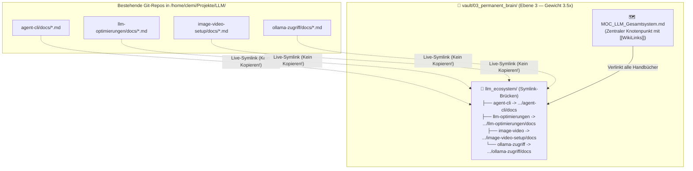

# 🎓💼 08. Anwendungsfälle (Studium & Beruf) + Sinnvolle Integration bestehender LLM-Dokus

> **Ziel:**  
> 1. Wie bringt dir das **3-stufige Zweite Gehirn** als **Student UND Berufstätiger** jeden Tag einen massiven Zeit- und Wissensvorsprung?  
> 2. Wie bindest du deine bereits vorhandenen, hochwertigen Markdown-Dokumentationen aus `/home/clemi/Projekte/LLM/` ein, **ohne Dateien doppelt zu kopieren oder Redundanzen zu erzeugen**?

---

## 🎯 Teil 1: Konkrete Anwendungsfälle als Student & Arbeitender

Der größte Hebel deines Systems liegt darin, dass **Wissen aus dem Studium** und **Erfahrung aus der Arbeit** im selben 3-Ebenen-Vault liegen, aber über Tags (`#studium/...`, `#arbeit/...`, `#projekt/...`) sauber getrennt oder bei Bedarf kombiniert werden können:

### 🎓 A. Im Studium (Vorlesungen, Klausuren, Haus-/Abschlussarbeiten)

| Anwendungsfall | 🟢 Ebene 1 (`01_fleeting_notes`) | 🟡 Ebene 2 (`02_literature_notes`) | 🔵 Ebene 3 (`03_permanent_brain`) |
| :--- | :--- | :--- | :--- |
| **1. Vorlesungsfolien & Skripte (300-Seiten-PDF)** | Vorlesungs-PDF in `00_inbox_raw/` werfen ➔ wird 1:1 zu `.md` konvertiert. | Lokale KI extrahiert pro Kapitel: **Definitionen, Formeln & Prüfungsfragen** (`promote --to-layer 2`). | Du speicherst die **10 wichtigsten Grundkonzepte des Moduls** als eigene vernetzte Notizen (`[[Gradient-Descent]]`, `[[Backpropagation]]`). |
| **2. Wissenschaftliche Papers (Bachelor-/Masterarbeit)** | 30 englische Research-Papers (PDF) per `ingest-all` einlesen. | KI erstellt für jedes Paper einen einheitlichen Steckbrief: *Methodik, Datensatz, Ergebnis, Schwächen*. | Deine eigene **Gliederung & Argumentationskette der Thesis** mit direkten `[[WikiLinks]]` auf die Paper-Exzerpte in Ebene 2! |
| **3. Aktive Klausurvorbereitung mit deiner KI** | Alte Übungsblätter & Altklausuren als Markdown. | Musterlösungen & Fehleranalysen. | **KI-Prüfungssimulator im Chat:** *„Durchsuche meine Ebene 3 und Ebene 2 zum Modul Verteilte Systeme und stelle mir 5 schwere Verständnisfragen!“* |

---

### 💼 B. Im Job / als Werkstudent / Entwickler (Projekte, Meetings, Verträge)

| Anwendungsfall | 🟢 Ebene 1 (`01_fleeting_notes`) | 🟡 Ebene 2 (`02_literature_notes`) | 🔵 Ebene 3 (`03_permanent_brain`) |
| :--- | :--- | :--- | :--- |
| **4. Meetings & Sprachnotizen (`Super + V` Diktat)** | Nach dem Meeting 2 Minuten per Whisper-Diktat sprechen oder rohes Protokoll einwerfen. | KI strukturiert daraus automatisch: **Entscheidungen, Offene To-Dos, Deadlines**. | Wichtige **Projekt-Architekturentscheidungen (ADRs)** wandern dauerhaft in Ebene 3 (damit du 6 Monate später noch weißt, *warum* etwas so gebaut wurde). |
| **5. Kunden-/Projekt-Dokus & Pflichtenhefte (PDF/DOCX)** | 80-seitiges Lastenheft oder API-Spezifikation vom Arbeitgeber/Kunden einlesen. | KI zieht alle **Anforderungen, Schnittstellen & Fristen** als kompakte Checkliste heraus. | Dein persönliches **Projekt-Cockpit (MOC)** in Ebene 3, das alle aktiven Tickets und Architekturen verknüpft. |
| **6. Persönliches „Bug- & Lösungs-Lexikon“** | Rohe Fehlermeldungen, Stacktraces oder Server-Logs. | Zusammenfassung der Ursache. | **Dein eigenes Engineering-Runbook:** *„Immer wenn Fehler X bei Docker/ROCm auftritt ➔ Lösung Y.“* (Nie wieder denselben Bug zweimal googeln!). |
| **7. Karriere, Verträge & Steuer/Finanzen (100 % Privat)** | Arbeitsvertrag, Gehaltsabrechnungen, Versicherungs-PDFs, Rechnungen (bleibt 100 % lokal auf deiner GPU!). | KI extrahiert Kündigungsfristen, Steuer-Posten für die Werbungskosten/Studienkosten. | Deine jährliche **Finanz- & Steuer-Übersicht** in Ebene 3. |

---

### ⚡ C. Der „Synergie-Effekt“ (Wenn Studium & Arbeit sich verbinden)
Weil beides in **einem** lokalen Gehirn liegt, kannst du Fragen stellen, die kein Cloud-ChatGPT beantworten könnte:
> *„Ich muss auf der Arbeit ein neues Monitoring-System entwerfen. Welche Konzepte aus meiner Vorlesung `Verteilte Systeme` (Studium) und welche bestehenden Skripte aus meinem `LLM-Projekt` kann ich dafür direkt wiederverwenden?“*

---
---

## 🔗 Teil 2: Wie integriere ich die bestehenden `.md`-Dokus aus dem `LLM`-Projekt sinnvoll?

In deinem Workspace `/home/clemi/Projekte/LLM/` hast du bereits **über 35 erstklassige, geprüfte Markdown-Handbücher** (z. B. in `agent-cli/docs/`, `llm-optimierungen/docs/`, `image-video-setup/docs/`, `ollama-zugriff/docs/`).

### ❌ Was du NICHT tun solltest:
Kopiere diese Dateien **nicht** von Hand in den Vault! Wenn du sie kopierst, hast du jede Datei doppelt und Änderungen in `agent-cli/docs/` kommen nicht im Zweiten Gehirn an.

### ✅ Die Gold-Standard-Lösung: Symbolische Links (Symlinks) direkt in Ebene 3 + MOC-Index!

Deine bestehenden LLM-Dokumentationen sind **keine ungeprüften Rohdaten (Ebene 1)**, sondern bereits **verifiziertes, produktives Systemwissen**. Sie gehören deshalb logisch direkt in **🔵 Ebene 3 (`03_permanent_brain/`)**!

Indem wir in `vault/03_permanent_brain/` einen Unterordner `llm_ecosystem/` per **Symlink** einhängen und dem Scanner (`os.walk(..., followlinks=True)`) erlauben, Symlinks zu folgen, erreichst du **3 Dinge gleichzeitig**:
1. **0 Byte doppelter Speicherplatz & 100 % Live-Sync:** Wenn du in `agent-cli/docs/` oder `llm-optimierungen/docs/` eine Anleitung änderst, ist sie **in derselben Sekunde** auch in Obsidian und in deiner `twin_memory.db`-Suche aktuell!
2. **Automatischer 3.5x Prioritäts-Boost:** Da die verlinkten Dokus unter `03_permanent_brain/` hängen, behandelt deine KI deine eigenen System-Handbücher automatisch als **verifiziertes Langzeitwissen (Ebene 3)**.
3. **Eine zentrale „Map of Content“ (`MOC_LLM_Gesamtsystem.md`):** Eine Übersichts-Notiz in Ebene 3 verknüpft alle deine bestehenden Teilprojekte (`agent-cli`, `llm-optimierungen`, `image-video-setup`, `ollama-zugriff`) per `[[WikiLinks]]` für den Obsidian Graph View.



---

## 🚀 1-Klick-Integration deiner bestehenden LLM-Dokus

Mit dem mitgelieferten Skript [`scripts/link_existing_llm_docs.sh`](file:///home/clemi/Projekte/LLM/digital-twin-memory/scripts/link_existing_llm_docs.sh) werden alle deine bestehenden `.md`-Handbücher sauber per Symlink in **Ebene 3** eingehängt, eine zentrale **Obsidian Map of Content (`MOC_LLM_Gesamtsystem.md`)** generiert und sofort in die SQLite-FTS5-Datenbank indexiert:

```bash
/home/clemi/Projekte/LLM/digital-twin-memory/scripts/link_existing_llm_docs.sh
```
*(Bereits ausgeführt — dein Zweites Gehirn kennt jetzt alle deine bestehenden LLM-Handbücher in Ebene 3!)*
